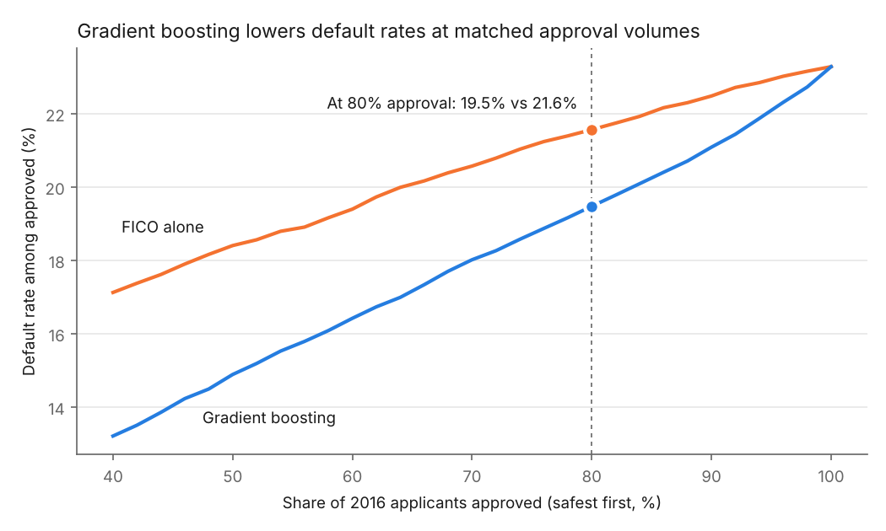
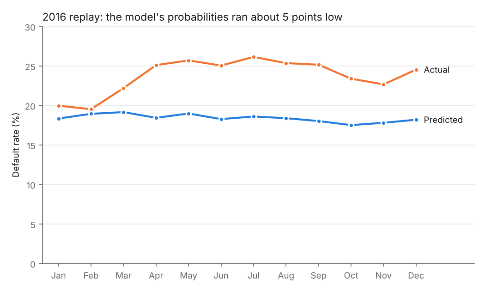

# Loan Default Prediction: Balancing Approval and Risk

Approving the lowest-risk 80% of 2016 loans with gradient boosting gives a 19.5% default rate among approved loans, against 21.6% when ranking by FICO alone and 23.3% with no screening. The model ranks risk as well in 2016 as in development, but its probabilities run almost 5 points low: no input field shifted noticeably (every PSI below 0.04), yet loans with the same score defaulted more often.





**Main findings**

- **Better decisions at the same volume (historical back-test).** Approving the safest 80% of 2016 loans, gradient boosting's approved loans default 2.1 points less often than FICO's (19.48% against 21.57%): 836 fewer defaulted loans out of 40,000.
- **Ranking held, probabilities did not.** Over all of 2016 the model ranked risk about as well as in development (ROC-AUC 0.6639 against 0.6633). In a month-by-month replay its probabilities ran 4.79 points low on average; the input monitor raised no alert, and only outcome monitoring caught the gap.
- **Large loans for the income stay riskier after adjustment.** Among comparable borrowers, loans of at least 25% of annual income default about 9 points more often (observational; section 12.5). An audit by group finds that applicants with low income or no stated employment length are approved far less often and are among the groups whose risk is understated most (section 13).

Both figures are drawn by `python -m loan_default.figures` from the current package (the approval curve is in `reports/approval_curve.csv`; the monthly figure reads the replay's `reports/replay_monthly.csv`). Headline numbers in this README come from the current package; sections 7–10 report notebook 05, which differs slightly because of library versions (section 16).

```bash
python -m pip install -e ".[dev,serve,tracking]"
python -m loan_default.train          # train and save the pipeline, about 20 seconds
uvicorn loan_default.service:app      # serve predictions on port 8000
```

| Part | Where |
|---|---|
| Problem, data, analysis and results | Sections 1–10, notebooks 01–05 |
| Drift, year-by-year validation, recalibration, 2016 replay | Section 11 |
| Imputation, embeddings, clustering, semi-supervised, causal inference, AutoML, explainability | Section 12 |
| Fairness audit and mitigations | Section 13 |
| Training, tracking, registry, API, Docker, CI | Section 16 |
| Production readiness (ML Test Score) | Section 17 |
| Model card; product and data management | [docs/](docs/) |

**Data:** Ariza-Garzón et al. (2024), [Lending Club loan dataset for granting models](https://doi.org/10.5281/zenodo.11295916), CC BY 4.0.

## 1. Project Overview

Lending decisions involve two competing goals: approving enough loans to maintain lending volume while limiting defaults. A stricter policy can reduce risk, but it also rejects borrowers who would have repaid.

Our main question is:

> If we approve the lowest-risk loans, how does the default rate change as we approve more or fewer loans?

We compare five model families against a FICO-only logistic regression baseline using application-time information. We evaluate model scores alongside approval rates and default rates among approved loans.

### Main result

On the 2016 test sample, approving the lowest-risk **80%** using tuned gradient boosting produced:

- **19.48%** default rate among approved loans.
- **21.57%** with FICO alone at the same approval rate.
- **23.28%** across all test loans.

At the same volume of **40,000 approved loans**, gradient boosting retained **836 fewer loans that ultimately defaulted** than the baseline. (These are the current package's numbers, `reports/approval_curve.csv`; notebook 05, section 10, reports 19.50%, 21.56% and 827.)

Risk ranking remained similar across CV and the later test cohort. However, the model underestimated 2016 default probabilities, making calibration an important remaining issue.

## 2. Business Objective and Problem Framing

### Business objective

Reduce defaults among approved loans while retaining a meaningful share of lending volume.

A policy that approves very few loans may achieve a low default rate without meeting lending-volume goals. We therefore compare models at matched approval rates and examine how risk changes as approval increases.

We ask:

- Does the model rank loan risk better than FICO alone?
- At the same approval rate, does it retain a lower-risk group?
- How many defaults are rejected, and how many fully paid loans are also rejected?

Financial returns, funding costs, and recoveries are unavailable, so we measure the approval–default trade-off rather than profit.

### Intended users and use

Credit-risk analysts could use scores to compare risk and investigate errors. Lending-policy teams could use approval curves to compare alternative policies.

The workflow is to collect application information, apply the fitted pipeline, generate risk scores, and apply a policy selected using development data.

### Machine learning task

This is a **supervised binary classification** problem.

- **Unit of analysis:** one loan.
- **Target:** `Default`.
- **Positive class, 1:** charged off.
- **Negative class, 0:** fully paid.
- **Training:** offline, using historical loans.
- **Output:** a score where higher values indicate higher default risk.

### Baseline

Manual underwriting and credit-score rules are common lending approaches. We use **FICO-only logistic regression** as a simple benchmark for assessing the value of additional application features.

## 3. Data Source and Split

**Citation.** Ariza-Garzón, M. J., Sanz-Guerrero, M., Arroyo Gallardo, J., & Lending Club. (2024). *Lending Club loan dataset for granting models* (Version 0.1) [Dataset]. Universidad Complutense de Madrid. <https://doi.org/10.5281/zenodo.11295916>. Licensed under [Creative Commons Attribution 4.0 International (CC BY 4.0)](https://creativecommons.org/licenses/by/4.0/). `data/train.csv` and `data/test.csv` are stratified samples drawn from it (150,000 loans from 2007–2015 and 50,000 from 2016); the values are unchanged.

The [source dataset](https://doi.org/10.5281/zenodo.11295916) contains **1,347,681 loans and 15 columns**, covering origination years **2007–2018**. It retains fully paid and charged-off loans and excludes transitional outcomes.

Rejected applications are absent. Our analysis therefore concerns historical issued loans with resolved outcomes.

### Train/test split

We separate origination periods before EDA and fitted preprocessing, then take stratified samples.

| Dataset | Issue years | Available pool | Sample size | Default rate |
|---|---|---:|---:|---:|
| Training / development | 2007–2015 | 829,347 | 150,000 | 18.46% |
| Test | 2016 | 293,057 | 50,000 | 23.28% |

Sampling is stratified by `Default`, with seed **42**. Sampled train and test IDs do not overlap. EDA uses the training sample.

Sampling makes repeated comparisons manageable while approximately preserving each period’s default prevalence.

### Why split by time?

The intended task is to learn from older loans and score newer applications. The 2016 test cohort provides a later-period comparison, with observed default prevalence increasing from **18.46%** to **23.28%**.

### Why exclude 2017–2018?

Only resolved loans remain in the dataset, so recent cohorts may overrepresent loans that reached a final outcome quickly. We exclude these years to reduce this outcome-selection concern.

### Evaluation boundaries

Aggregate test prevalence was inspected in the split notebook, and the pipeline notebook documents test-period DTI anomalies. The test sample was therefore not completely unseen during development.

Model fitting, hyperparameter search, and approval-fraction selection use training data. Notebook 05 reports that its model and policy choices were fixed before final test evaluation.

Outcome-availability dates are missing. Some earlier loans may have resolved after 2016, so the split compares origination cohorts rather than fully reconstructing historically available training labels.

## 4. Exploratory Data Analysis

[Notebook 02](notebooks/02_eda.ipynb) profiles each variable’s type, missingness, unusual values, distribution, and usefulness.

### Variable summary

| Variable | Meaning | Treatment |
|---|---|---|
| `id` | Loan identifier | Overlap checks; excluded from predictors |
| `issue_d` | Issue month and year | Temporal splitting and cohort analysis |
| `revenue` | Self-reported annual income | Log transformation and standardization |
| `dti_n` | Monthly debt-to-income ratio, excluding mortgage, as defined by the source | Cleaning, median imputation and standardization |
| `loan_amnt` | Requested loan amount | Log transformation and standardization |
| `fico_n` | Midpoint of reported FICO range | Median imputation and standardization |
| `experience_c` | Borrower-experience indicator | Excluded because it is nearly constant |
| `emp_length` | Employment length | Numeric years, imputation and missingness indicator |
| `purpose` | Loan purpose | One-hot encoding with rare-category grouping |
| `home_ownership_n` | Housing status | One-hot encoding with rare-category grouping |
| `addr_state` | State of residence | Smoothed target encoding with cross-fitting |
| `zip_code` | Partially masked ZIP code | Excluded |
| `title` | Borrower-provided loan title | Excluded because of high cardinality and overlap with purpose |
| `desc` | Borrower-provided loan description | Excluded because of missingness and changing availability |
| `Default` | Charged off or fully paid | Target |

### Main findings

- Approximately **18.5%** of training loans defaulted.
- Income has skew around **46.4** and a maximum of **USD 9.5 million**.
- Log transformation reduces income skew to approximately **0.18**.
- About **5.2%** have `emp_length = NI`, with an observed default rate of approximately **23.7%**.
- Only **5 of 150,000** training observations have `experience_c = 0`.
- ZIP code has **879 categories**; approximately **20%** have fewer than 30 observations.
- Loan descriptions are approximately **86% missing** and almost absent in 2015.
- Only **90 training observations** have FICO below 660.

### Charts and takeaways

| Chart | Main takeaway |
|---|---|
| Default rate by FICO | Higher FICO bands generally have lower default rates |
| Default rate by purpose | Small-business loans have higher observed default rates than car loans |
| Default rate by home ownership | Renters have higher observed default rates than mortgage holders |
| Default rate by year | Rates vary over time and rise in later training years |
| Default rate by loan-to-income | Higher ratio groups have higher observed default rates |

Individual numeric rank correlations with default are weak. We therefore test combinations of features and evaluate their contribution through validation.

### Useful additional data

| Additional data | Purpose |
|---|---|
| Income verification | Assess reporting reliability |
| Dates when outcomes became known | Reconstruct historically available labels |
| Recent cohorts with sufficient follow-up | Assess current relevance |
| Loan returns, costs and recoveries | Evaluate financial value |
| Broader application records | Understand coverage beyond approved applicants |
| Appropriate protected-group information | Assess approval and error disparities directly |

## 5. Preprocessing and Feature Engineering

[Notebook 03](notebooks/03_pipeline.ipynb) explains the shared pipeline in [preprocessing.py](src/loan_default/preprocessing.py).

Full models use eight original application inputs and the engineered `loan_to_income` feature.

### Cleaning

- Convert employment length to numeric years from 0 to 10.
- Map `NI` to missing and preserve missingness through an indicator.
- Treat DTI equal to 999 as missing.
- Cap DTI at 100.
- Calculate `loan_to_income = loan_amnt / revenue`.
- Drop identifiers, issue date, experience indicator, ZIP code, title and description.

The source does not explain DTI equal to 999. Treating it as missing is an explicit assumption. The training sample has no such values and no DTI above 100; these rules handle later-period observations.

### Transformations

| Group | Features | Transformation |
|---|---|---|
| Numeric | FICO, DTI, employment length | Median imputation with missing indicators, then standardization |
| Skewed numeric | Income, loan amount, loan-to-income | `log(1 + x)`, then standardization |
| Categorical | Purpose, housing status | One-hot encoding; categories with fewer than 500 observations grouped as infrequent |
| Geographic | State | Target encoding with smoothing of 100 and internal cross-fitting |

Income percentile clipping and FICO bands were not included in the final shared pipeline.

The full-training pipeline check produces **24 numeric columns**, with no remaining missing values.

### Leakage control

Learned preprocessing is fitted inside each CV training fold. State target encoding uses internal cross-fitting so a row’s own target does not determine its training encoding.

The FICO-only baseline uses a separate pipeline with FICO imputation and scaling.

## 6. Evaluation Metrics

### ROC-AUC

ROC-AUC measures how well a model ranks defaulted loans above fully paid loans. It is the primary metric for model comparison and hyperparameter selection.

### Average Precision

We report **Average Precision (AP)** using `average_precision_score`, alongside precision–recall analysis.

AP focuses on default identification in an imbalanced dataset. The prevalence reference is **18.46%** in training and **23.28%** in testing. AP differs from trapezoidal PR-AUC, so we label it explicitly.

### Approval and default rates

`Approval rate = approved loans / evaluated loans`

`Approved-loan default rate = defaults among approved loans / approved loans`

Models are compared at the same approval rate, so lower risk is not achieved simply by approving fewer loans. Approval here means retaining loans from the historical issued-loan sample.

### Supporting diagnostics

We examine confusion matrices, default precision and recall, Brier score, and calibration.

Accuracy alone is insufficient: predicting every training loan as fully paid achieves approximately **81.5% accuracy** while identifying no defaults.

## 7. Model Comparison and Shortlist

[Notebook 04](notebooks/04_modeling_baseline.ipynb) compares five model families against the FICO-only baseline.

All models use **stratified five-fold CV**, with shuffling and seed **42**. Learned preprocessing is fitted separately within each fold. Results are mean ± sample standard deviation.

| Model | CV ROC-AUC | CV AP |
|---|---|---|
| Gradient boosting | 0.6627 ± 0.0047 | 0.3007 ± 0.0084 |
| Logistic regression | 0.6610 ± 0.0047 | 0.2965 ± 0.0083 |
| Random forest | 0.6608 ± 0.0041 | 0.2970 ± 0.0065 |
| Extra Trees | 0.6554 ± 0.0039 | 0.2930 ± 0.0087 |
| Decision tree | 0.6420 ± 0.0044 | 0.2736 ± 0.0057 |
| FICO-only baseline | 0.5904 ± 0.0043 | 0.2254 ± 0.0028 |

All multivariable models outperform the FICO-only baseline.

We shortlisted:

1. **Gradient boosting:** highest mean ROC-AUC and AP.
2. **Logistic regression:** similar performance with a simpler model.
3. **Random forest:** a competitive alternative ensemble approach.

The small differences between these candidates motivate examining tuning gains and complexity.

Shuffled CV mixes origination years. The separate 2016 test provides the later-cohort evaluation, and section 11 adds a year-by-year chronological check.

## 8. Feature Importance and Error Analysis

### Important variables

Held-out permutation importance uses up to 3,000 observations from the first validation fold and five permutations per feature.

For gradient boosting:

| Original input | Mean ROC-AUC reduction after permutation |
|---|---:|
| FICO | 0.0673 |
| Loan amount | 0.0657 |
| Income | 0.0340 |
| DTI | 0.0264 |

Shuffling loan amount or income also changes the derived loan-to-income feature. These values measure predictive contribution through the pipeline, rather than causal effects.

### Default threshold

At the preliminary threshold of **0.50**, untuned gradient boosting identified only **82 of 27,684** training defaults in out-of-fold predictions.

Most scores fall below 0.50. This produces high accuracy but very low default recall, motivating a policy based on approval volume.

### Business errors

With default as the positive class:

- **False approval:** approve a loan that defaults — false negative.
- **False rejection:** reject a loan that repays — false positive.

Notebook 04 examines errors across FICO, predicted risk, housing, purpose, employment information, and other loan characteristics. Verified income and more detailed repayment obligations would help investigate individual errors.

## 9. Hyperparameter Tuning and Ensembles

[Notebook 05](notebooks/05_tuning_and_final_evaluation.ipynb) tunes the three shortlisted models using `RandomizedSearchCV` and the same five-fold design.

### Search budgets

| Model | Configurations | Main parameters |
|---|---:|---|
| Gradient boosting | 40 | Learning rate, iterations, leaf count, minimum leaf size, regularization, feature fraction |
| Random forest | 20 | Tree count, depth, minimum leaf size, feature fraction |
| Logistic regression | 15 | Regularization strength and L1/L2 penalty |

ROC-AUC determines the selected configuration; AP is also recorded. Randomized search explores broad ranges within a manageable number of fits.

### Tuning results

| Model | Untuned CV ROC-AUC | Tuned CV ROC-AUC | Tuned AP |
|---|---:|---|---:|
| Gradient boosting | 0.6627 | 0.6636 ± 0.0046 | 0.3012 |
| Random forest | 0.6608 | 0.6612 ± 0.0039 | 0.2973 |
| Logistic regression | 0.6610 | 0.6610 ± 0.0047 | 0.2966 |

The largest tuning gain is approximately **0.0009 ROC-AUC**. Search adds little compared with the improvement from using more information than FICO alone.

### Final gradient boosting configuration

The final estimator is `HistGradientBoostingClassifier`, with settings rounded here for readability:

| Parameter | Value |
|---|---:|
| `learning_rate` | 0.0249 |
| `max_iter` | 510 |
| `max_leaf_nodes` | 15 |
| `min_samples_leaf` | 337 |
| `l2_regularization` | 0.0257 |
| `max_features` | 0.5823 |

Full-precision values are in [reports/best_params.json](reports/best_params.json), and all 40 configurations in [reports/search_results.csv](reports/search_results.csv); `python -m loan_default.search` reruns the search. Early stopping can stop fitting before the maximum iteration count.

### Ensembles

We tested soft voting and stacking with a logistic-regression meta-model and internal five-fold CV.

Both achieved approximately **0.6642 CV ROC-AUC**, versus **0.6636** for tuned gradient boosting, without an AP improvement. Component predictions were highly correlated, approximately **0.93–0.97**.

We retained gradient boosting because the small gain did not justify running three models. The notebook required a gain larger than one fold standard deviation as a practical complexity rule, not a significance test.

## 10. Approval Policy and Final Test Results

### Policy selection

Using out-of-fold training predictions, we selected **80% approval** before final test evaluation.

We evaluated:

1. **Fixed approval fraction:** approve the lowest-risk 80% of the scored batch.
2. **Fixed training cutoff:** apply the threshold derived from training predictions.

Score ties in the fixed-fraction policy are broken randomly with seed **42**, particularly important for the FICO baseline.

At 80% training approval, approved-loan default rates were **15.06%** for gradient boosting and **17.08%** for FICO. Training-derived cutoffs were **0.2565** and **0.2281**, respectively.

The final model and baseline were fitted on all 150,000 training loans. Notebook 05 reports that predictions were saved after final test scoring and no further tuning followed.

### Predictive performance

| Model | Test ROC-AUC | Test AP | Test Brier |
|---|---:|---:|---:|
| FICO-only baseline | 0.5943 | 0.2822 | 0.1774 |
| Tuned gradient boosting | 0.6639 | 0.3598 | 0.1706 |

Gradient boosting improves test ROC-AUC by approximately **0.0696**. Its test score is close to its **0.6636** tuned CV result, showing similar ranking performance on the later cohort.

### Approval and default rates

| Policy | Approval rate | Approved loans | Approved-loan default rate |
|---|---:|---:|---:|
| Retain all test loans | 100.00% | 50,000 | 23.28% |
| FICO-only, safest 80% | 80.00% | 40,000 | 21.56% |
| Gradient boosting, safest 80% | 80.00% | 40,000 | 19.50% |
| FICO-only, training cutoff | 81.24% | 40,621 | 21.70% |
| Gradient boosting, training cutoff | 80.07% | 40,036 | 19.50% |

At matched 80% approval, gradient boosting lowers the default rate by approximately **2.07 percentage points** relative to FICO alone.

At 50% approval, test default rates are **14.86%** for gradient boosting versus **18.40%** for FICO. At 90%, they are **21.08%** versus **22.48%**. Gradient boosting has lower observed default rates at each evaluated approval fraction from 10% to 90%.

### Errors at 80% approval

| Outcome | Gradient boosting | FICO-only |
|---|---:|---:|
| Approved and fully paid | 32,201 | 31,374 |
| Approved and defaulted | 7,799 | 8,626 |
| Rejected and fully paid | 6,158 | 6,985 |
| Rejected and defaulted | 3,842 | 3,015 |

Gradient boosting rejects **33.0%** of defaults, compared with **25.9%** for FICO.

However, **61.58%** of rejected loans were fully paid. Better ranking reduces errors relative to the baseline but still excludes many borrowers who repay.

### Bootstrap uncertainty

Notebook 05 uses **1,000 paired bootstrap resamples** of the test sample. The 95% percentile interval for the approved-loan default-rate difference, gradient boosting minus FICO at 80% approval, is approximately **−2.37 to −1.85 percentage points**.

This describes uncertainty within the observed test sample, not retraining variability or future changes in lending conditions.

## 11. Calibration and Temporal Change

Ranking remained stable, but calibration changed.

On training out-of-fold predictions, predicted and observed default rates were within approximately **0.7 percentage points** across ten risk groups.

On the 2016 test sample:

- Mean predicted default probability: **18.49%**
- Actual default prevalence: **23.28%**

The model underestimated defaults across all ten test risk groups.

Risk ranking and probability accuracy therefore need separate evaluation. The model identifies relatively safer loans, while its numerical probabilities understate the later cohort’s default level.

### What changed between the periods

[`python -m loan_default.drift`](src/loan_default/drift.py) compares the 2016 sample with the training sample and writes [reports/drift_report.md](reports/drift_report.md).

**The inputs barely changed.** The population stability index (PSI) is below 0.04 for all nine model features, against a usual threshold of 0.10 for a moderate shift. The largest values are for state (0.038) and loan purpose (0.036). Every two-sample test rejects equality (p < 0.01), but with 150,000 and 50,000 loans the tests detect differences too small to matter, so drift is read from PSI.

**Loans of the same predicted risk defaulted more often.** Grouping loans into deciles of predicted risk, the 2016 default rate is higher in every band, by 1.7 percentage points in the safest band and 5.3 to 7.4 points in the riskier half.

| | Default rate |
|---|---:|
| Training sample | 18.46% |
| 2016, if only the mix of risk bands had changed | 18.47% |
| 2016, actual | 23.28% |

Of the 4.83-point increase, 0.01 points come from a different mix of risk bands and 4.82 points from higher default rates within bands of the same model score. The bands are deciles of the model's score (out-of-fold scores for training, a model fitted on all of 2007–2015 for 2016), so this decomposition describes the score, not the inputs themselves: it shows that the rise sits inside score bands, but it cannot separate a change in the mix of inputs that the score does not capture from a change in the link between inputs and default, and small per-feature PSI does not rule out a change in their joint distribution. It is consistent with the pattern above: ranking held, while probabilities were too low because the overall level moved.

The increase continues a trend inside the training period: 15.49% for 2013 originations, 18.13% for 2014, 20.32% for 2015. The data cannot separate two explanations. Credit quality may have worsened. Alternatively, because only resolved loans are kept and defaults resolve sooner than full repayment, recent cohorts may over-represent defaults (section 14). Monitoring input distributions alone would not have flagged this change; detecting it needs outcome labels.

### Would chronological validation have shown it?

[`python -m loan_default.temporal`](src/loan_default/temporal.py) scores each year with a model trained only on earlier years ([reports/temporal_validation.md](reports/temporal_validation.md)).

| Evaluated year | Trained on | ROC-AUC | Mean predicted | Actual | Gap |
|---|---:|---:|---:|---:|---:|
| 2012 | 7,696 | 0.6275 | 17.95% | 16.65% | −1.30 pp |
| 2013 | 17,290 | 0.6320 | 18.07% | 15.49% | −2.59 pp |
| 2014 | 41,842 | 0.6474 | 16.89% | 18.13% | +1.23 pp |
| 2015 | 82,077 | 0.6669 | 17.81% | 20.32% | +2.52 pp |
| 2016 | 150,000 | 0.6639 | 18.49% | 23.28% | +4.79 pp |

Shuffled 5-fold CV on 2007–2015 gives ROC-AUC 0.6633 (out-of-fold scores pooled across folds) and a mean prediction equal to the observed rate (18.46%).

**Ranking:** shuffled CV did not overstate it. Chronological ROC-AUC rises with the size of the training set and reaches 0.667 for 2015, in line with the shuffled estimate and the 2016 result.

**Calibration:** shuffled CV hid the problem. Every fold mixes all years and keeps the default rate of the whole sample (the folds are stratified), so out-of-fold predictions match the overall rate. Scored year by year, the model overpredicts in 2012–2013, when defaults fell, and underpredicts from 2014, by 1.2 points and then 2.5 points. The 4.8-point gap in 2016 continues a trend that this check shows in the development data.

**Tuning on year-ordered folds does not fix it.** `python -m loan_default.search --folds chronological` reruns the 40-configuration search with one fold per year from 2012 to 2015, each trained on earlier years only ([reports/search_results_chronological.csv](reports/search_results_chronological.csv)). It picks a different configuration: a lower learning rate (0.0125) and smaller trees (7 leaves). On 2016:

| Tuned on | Test ROC-AUC | Test AP | Brier | Mean predicted | Default rate, safest 80% |
|---|---:|---:|---:|---:|---:|
| Shuffled folds (current model) | 0.6639 | 0.3599 | 0.1706 | 18.49% | 19.48% |
| Year-ordered folds | 0.6621 | 0.3585 | 0.1712 | 18.39% | 19.53% |

The two are within the spread of the search itself (the top five chronological configurations lie within 0.002 ROC-AUC), and neither moves the mean prediction toward the 23.28% observed. Hyperparameters set how risk is ranked, not the level the model expects, so the current model is kept and the calibration gap is handled by recalibration below.

### Does recalibration help?

[`python -m loan_default.recalibration`](src/loan_default/recalibration.py) fits a correction on loans issued in January–June 2016 and judges it on loans issued in July–December 2016 ([reports/recalibration_report.md](reports/recalibration_report.md)).

| Method | Mean predicted | Actual | Brier | Mean gap over 10 risk bins | ROC-AUC |
|---|---:|---:|---:|---:|---:|
| No recalibration | 18.11% | 24.59% | 0.1794 | 6.49 pp | 0.6587 |
| Intercept shift | 21.67% | 24.59% | 0.1757 | 2.93 pp | 0.6587 |
| Platt scaling | 21.64% | 24.59% | 0.1758 | 2.95 pp | 0.6587 |
| Isotonic | 21.66% | 24.59% | 0.1758 | 2.93 pp | 0.6578 |

Recalibration removes a little over half of the gap. In this back-test the three methods perform about equally, so one constant on the log-odds scale does as well as a flexible mapping; this is consistent with the error being mostly a shift in level, though one half-year comparison cannot prove it. The remaining gap exists because the default rate kept rising within 2016, from 22.39% in the first half to 24.59% in the second, so a correction fitted on one period is already behind in the next.

The intercept shift and Platt scaling are strictly increasing, so they keep the ranking (ROC-AUC 0.6587 unchanged) and a policy that approves a fixed share of applicants approves the same loans. Isotonic recalibration is only non-decreasing: it creates ties and lowers ROC-AUC to 0.6578, which can change which loans fall in the safest 80%. A policy that applies a fixed probability cutoff, as the service does, approves different loans after any recalibration unless the cutoff is transformed with it. Recalibration matters most where the probability itself is used, for example in pricing or loss forecasts.

In production the first half's outcomes would not be known by the second half, so a live correction would use older labels and lag further.

### Replaying 2016 as if the model were live

[`python -m loan_default.replay`](src/loan_default/replay.py) trains on 2007–2015, scores each 2016 loan in the month it was issued, writes the predictions in the service's log format, and runs both monitors on them ([reports/replay_report.md](reports/replay_report.md)).

| Month | Largest input PSI | Mean predicted | Actual | Gap |
|---|---:|---:|---:|---:|
| 2016-01 | 0.053 | 18.34% | 19.96% | +1.62 pp |
| 2016-02 | 0.037 | 18.94% | 19.52% | +0.58 pp |
| 2016-03 | 0.066 | 19.15% | 22.19% | +3.04 pp |
| 2016-04 | 0.051 | 18.43% | 25.10% | +6.67 pp |
| 2016-05 | 0.058 | 18.98% | 25.70% | +6.72 pp |
| 2016-06 | 0.064 | 18.27% | 25.05% | +6.78 pp |
| 2016-07 | 0.085 | 18.60% | 26.14% | +7.54 pp |
| 2016-08 | 0.086 | 18.38% | 25.35% | +6.97 pp |
| 2016-09 | 0.092 | 18.02% | 25.15% | +7.13 pp |
| 2016-10 | 0.088 | 17.51% | 23.38% | +5.87 pp |
| 2016-11 | 0.091 | 17.80% | 22.66% | +4.86 pp |
| 2016-12 | 0.092 | 18.19% | 24.53% | +6.34 pp |

**The input monitor stays quiet while the model is wrong.** No month reaches PSI 0.10. The largest monthly value climbs from about 0.05 to 0.09, driven from July by the state mix; random training samples of one month's size score about 0.02 on state, so the shift is real but small. Run on the replayed log, the weekly drift check passes.

**The outcome monitor catches it.** [`loan_default.monitor`](src/loan_default/monitor.py) joins outcomes to predictions by application id and flags any month whose actual default rate is more than 2 points from the predicted rate. It flags every month from March, and its command exits with an error.

**How early it fires depends on how soon outcomes are known.** The delays below are assumptions about when a lender knows a month's default rate well enough to compare; the dataset records only the final status. Recalibration shifts the log-odds by a constant fitted on the 2016 months whose outcomes are already known.

| Outcomes known after | Outcome alert fires | Mean monthly gap (points), no recalibration | Quarterly | Monthly |
|---|---|---:|---:|---:|
| 3 months | June 2016 | 5.3 | 3.3 | 3.1 |
| 6 months | September 2016 | 5.3 | 4.3 | 4.2 |
| 12 months | March 2017 | 5.3 | 5.3 | 5.3 |

With a three-month delay, monthly recalibration cuts the average gap from 5.3 to 3.1 points; with a twelve-month delay nothing can be corrected within the year. The speed of outcome data, not the model, sets how quickly this kind of error is caught. An earlier signal such as missed first payments would shorten the delay, but this dataset does not record payments.

### The four kinds of drift, and where each is measured

| Drift | Question | Where | 2016 finding |
|---|---|---|---|
| Feature drift | Did the inputs change? | `drift.py` section 1 (PSI, KS and chi-squared per feature, plus the change in share missing); weekly in `drift.yml` | Stable: every PSI below 0.04, missing shares within 1.2 points |
| Target drift | Did the default rate change? | `drift.py` section 2 (default rate by issue year); `monitor.py` by month | Yes: 18.5% to 23.3%, continuing a rise from 2013 |
| Concept drift (indicator) | Do loans of the same predicted risk default more often? | `drift.py` sections 3–4 (default rate within score bands; gap split into band mix and within-band change) | Yes: +4.82 of the +4.83-point rise is within score bands. Consistent with concept drift, but a score-band split cannot rule out input changes the score does not capture |
| Prediction drift | Did the distribution of scores change? | `replay.py` (mean predicted per month); service log | Small: monthly mean prediction stays between 17.5% and 19.2% |
| Model performance | Are ranking and calibration holding? | `temporal.py` year by year; `monitor.py` calibration gap per month, with alert | Ranking holds (ROC-AUC 0.664); calibration gap of +4.8 points |
| Hyperparameters | Which settings produced the served model? | MLflow run parameters, `metadata.json`, registry version | Recorded for every training run |

## 12. Further Techniques: Imputation, Embeddings, Clustering, Semi-Supervised Learning, Causal Inference, AutoML and Explainability

Each technique below is a module under `src/loan_default/` with unit tests. Each one writes a report to `reports/`, and the numbers here come from those reports. Every model comparison uses the same harness ([experiments.py](src/loan_default/experiments.py)): shuffled 5-fold CV on 2007–2015, then a refit scored on 2016.

These are exploratory comparisons: one development sample, one test cohort, one training seed, and settings such as the number of clusters chosen on the same development data they are scored on. A difference of a few thousandths in ROC-AUC is not an established improvement; paired intervals over several seeds, or a new cohort, would be needed to settle it. The production model is unchanged by this section.

| Technique | Module | Report | Headline |
|---|---|---|---|
| Advanced imputation | `imputation` | [imputation_report.md](reports/imputation_report.md) | Iterative imputation recovers hidden values best; for the model, the missing flag matters more than the fill value |
| Entity embeddings | `embedding` | [embedding_report.md](reports/embedding_report.md) | Boosting on learned embeddings: +0.0007 test ROC-AUC; adding ZIP lowers ROC-AUC, while the approval metric moves the other way |
| PCA and clustering | `unsupervised` | [unsupervised_report.md](reports/unsupervised_report.md) | Four readable borrower segments, default rates 9%–26%; no accuracy gain as features |
| Semi-supervised learning | `semi_supervised` | [semi_supervised_report.md](reports/semi_supervised_report.md) | Label spreading helps when 1% of outcomes are known (+0.010 ROC-AUC); self-training hurts; labels matter far more than method |
| Causal inference | `causal` | [causal_report.md](reports/causal_report.md) | After adjustment, loans of at least 25% of income default about 9 points more often; observational, under stated assumptions |
| Bayesian HPO and AutoML | `hpo` | [hpo_report.md](reports/hpo_report.md) | Against a matched random-sampler run, TPE's best is 0.0002 higher in CV and no better on 2016; the surface is flat, so production keeps its parameters |
| Explainability | `explain` | [explainability_report.md](reports/explainability_report.md) | FICO and loan size relative to income drive scores; per-applicant contributions (not validated decline reasons) |
| Fairness audit | `fairness` | [fairness_report.md](reports/fairness_report.md) | Section 13 |

```bash
python -m pip install -e ".[research]"     # optuna, shap, matplotlib
python -m loan_default.imputation           # about 7 minutes on four cores
python -m loan_default.embedding            # about 1 minute
python -m loan_default.unsupervised         # about 1 minute
python -m loan_default.semi_supervised      # about 7 minutes
python -m loan_default.causal               # about 4 minutes
python -m loan_default.hpo [--track]        # about 25 minutes; --track logs every trial to MLflow
python -m loan_default.explain              # about 1 minute
python -m loan_default.fairness             # about 2 minutes
```

### 12.1 Advanced imputation

After cleaning, the only gaps in training data are in employment length (5.2% missing). Whether the value is missing carries information: **23.7%** of loans without an employment length defaulted, against **18.2%** of loans with one. We compared mean and median filling with two model-based imputers. **Iterative** (scikit-learn's `IterativeImputer`, a single MICE-style imputation) predicts each column from the others with chained regressions. **KNN** averages the 10 most similar loans. The model-based imputers see income and loan size, so these can inform a missing value.

*Recovering values hidden at random.* Each imputer is fitted on half of a 30,000-loan sample; 10% of the known FICO, DTI and employment values in the other half are hidden, imputed and compared with the truth (RMSE):

| Column | Median | Mean | Iterative | KNN |
|---|---:|---:|---:|---:|
| FICO | 30.76 | 29.36 | **29.07** | 30.61 |
| DTI | 8.35 | 8.34 | **7.93** | 8.35 |
| Employment years | 3.65 | 3.65 | **3.60** | 3.81 |

In this comparison all imputers handle the six numeric and log-scaled columns together; production fills only the three numeric columns, which is where its gaps are.

*Effect on the model:*

| Imputer | CV ROC-AUC | Test ROC-AUC | Test default rate, safest 80% |
|---|---:|---:|---:|
| Median + missing flag (production) | 0.6633 | 0.6639 | 19.48% |
| Iterative + missing flag | 0.6634 | 0.6641 | 19.41% |
| KNN + missing flag | 0.6635 | 0.6637 | 19.49% |
| Median, no flag | 0.6630 | 0.6628 | 19.46% |
| Iterative, no flag | 0.6628 | 0.6625 | 19.51% |

The iterative imputer recovers values best, but the application fields are only weakly related to each other, so it barely beats the mean. For the model, the **missing-value flag** matters most: removing it lowers test ROC-AUC by about 0.001 with either imputer, because a missing employment length is itself predictive. That is evidence the missingness is informative, not proof that it is "missing not at random" in the statistical sense. The iterative imputer with the flag differs from production by 0.0002, too small to act on, so production keeps median imputation. `build_preprocessor(numeric_imputer="iterative")` switches imputers if a future data source has more gaps.

### 12.2 Entity embeddings

[embedding.py](src/loan_default/embedding.py) learns a short vector for each state, loan purpose, housing status and ZIP prefix while predicting default (Guo & Berkhahn, 2016). The network is written in NumPy, so the project needs no deep-learning framework. Each categorical field gets an embedding of size min(10, levels/2), and levels with fewer than 30 loans share a "rare or unseen" vector. The embeddings and the scaled numeric fields feed one ReLU layer of 32 units and then a sigmoid output. Training uses Adam with weight decay and early stopping on a held-out 10%. A unit test checks every gradient against finite differences.

| Model | CV ROC-AUC | Test ROC-AUC | Test AP | Test default rate, safest 80% |
|---|---:|---:|---:|---:|
| One-hot + target encoding (production) | 0.6633 | 0.6639 | 0.3599 | 19.48% |
| Embedding network on its own | 0.6626 | 0.6638 | 0.3577 | 19.39% |
| Boosting on learned embeddings | **0.6642** | **0.6646** | **0.3606** | 19.45% |
| Embedding network, with ZIP | 0.6606 | 0.6617 | 0.3557 | 19.38% |
| Boosting on learned embeddings, with ZIP | 0.6584 | 0.6626 | 0.3571 | 19.38% |

- **A one-layer network nearly matches gradient boosting** in ranking (0.6638 against 0.6639) and has a lower default rate among the safest 80% (19.39% against 19.48%). Which model is "best" depends on the metric, and none of these differences is established.
- **Embeddings as boosting inputs have the highest ROC-AUC** (+0.0007 test, +0.0009 CV), a small difference from one seed. There is also a design caveat: the network learns the embeddings from the same training rows that the boosting model then trains on, so rare categories can carry some of their own outcomes into the features, as target encoding does without cross-fitting. Testing the gain properly needs embeddings fitted on data the boosting model does not train on.
- **ZIP code lowered ranking in these two embedding models.** Test ROC-AUC falls by 0.001–0.002; a likely reason, not tested separately, is that its 879 prefixes, many with few loans, let the models fit noise (their default rate among the safest 80% does not rise, so the evidence is mixed by metric). That supports excluding ZIP (section 13) without evidence of an accuracy cost, but it does not show that ZIP has no predictive value in any representation.
- **The embeddings are interpretable.** The first principal component of the state embeddings correlates **0.90** with each state's default rate, so the network recovers what target encoding captures. The remaining dimensions group states with similar borrowers ([state_embeddings.png](reports/figures/state_embeddings.png)).

### 12.3 Dimensionality reduction and clustering

**PCA.** The 23 preprocessed features show little redundancy. The first component explains only 10.1% of the variance (housing status and income), the second 8.5% (debt consolidation and loan-to-income), and 95% of the variance needs 19 components. A model trained on those 19 components loses 0.0016 test ROC-AUC (0.6624). Two things change at once, dropping the last 4 components and rotating the features away from the axis-aligned splits trees use, so the loss cannot be pinned on either. PCA is useful here for description, not as model input.

**K-means clustering** on the six-field financial profile (FICO, DTI, employment length, log income, log loan, log loan-to-income). Silhouette scores are low (0.18 at k = 2, falling slowly), so borrowers form a continuum rather than distinct groups. We use k = 4, the largest k within 0.01 of the best silhouette, as a readable segmentation:

| Segment | Share | Mean FICO | Median income | Loan / income | Median DTI | Default 2007–15 | Default 2016 |
|---|---:|---:|---:|---:|---:|---:|---:|
| High FICO, low DTI | 12.0% | 757 | $74,000 | 0.20 | 13.7 | 8.7% | 11.1% |
| Small loans, short employment | 27.7% | 686 | $50,000 | 0.12 | 16.9 | 15.7% | 20.8% |
| Higher income, long employment | 27.0% | 690 | $100,000 | 0.17 | 13.6 | 15.9% | 21.4% |
| Large loan for income, high DTI | 33.3% | 691 | $51,000 | 0.33 | 23.2 | 26.3% | 32.5% |

The segments separate default risk threefold, and their order is unchanged in 2016. Every segment's default rate rose by 2–6 points, which matches the uniform level shift found in section 11. The riskiest segment is defined by debt burden, not credit score: its mean FICO is the same as the middle two segments'. This makes the segments useful for policy discussions and monitoring. A separate k-means with four centres, fitted inside each training fold on all preprocessed features (not just the six-field profile above), adds the distances to its centres as model features; test ROC-AUC changes by +0.0001. The number of clusters was chosen on the same development data, so this is an exploratory result.

### 12.4 Semi-supervised learning

[semi_supervised.py](src/loan_default/semi_supervised.py) asks whether unlabeled loans help when few outcomes are known. It hides the outcome of all but 1%, 5% or 20% of the 2007–2015 loans, chosen at random within each class, trains six methods with the same gradient boosting learner, and scores each on the fully labeled 2016 sample. Each setting is repeated on three random labeled subsets. Every method stops boosting early on the same held-out 15% of the labeled loans, which never receive pseudo-labels or duplicates, and the state encoding is cross-fitted on the labeled training loans.

| Method | 1% labeled (~1,500) | 5% labeled (~7,500) | 20% labeled (~30,000) |
|---|---:|---:|---:|
| Labeled only | 0.6140 (±0.0087) | 0.6462 (±0.0031) | 0.6564 (±0.0008) |
| Self-training (threshold 0.9) | 0.5790 (±0.0313) | 0.6141 (±0.0310) | 0.6399 (±0.0046) |
| Balanced self-training | 0.6068 (±0.0083) | 0.6287 (±0.0038) | 0.6349 (±0.0022) |
| Cluster soft labels (k-means) | 0.6106 (±0.0022) | 0.6428 (±0.0011) | 0.6540 (±0.0011) |
| **Label spreading** (10-NN graph) | **0.6242** (±0.0038) | **0.6469** (±0.0015) | **0.6582** (±0.0009) |
| Cluster features | 0.6122 (±0.0051) | 0.6413 (±0.0020) | 0.6560 (±0.0006) |

Test ROC-AUC, mean (± standard deviation) over three labeled subsets. With every outcome known, the production model reaches 0.6639. The report also gives each method's change against labeled-only on the same subset.

- **Labels matter far more than method.** Going from 1% to 20% labeled adds about 0.04 ROC-AUC.
- **Label spreading is the only method whose average ROC-AUC beats labeled-only at every label share**, mostly when labels are scarcest (three labeled subsets, one 2016 cohort): +0.010 ROC-AUC at 1% labeled, positive on all three subsets (+0.005 to +0.015), and +0.002 at 20%. At 5% the change is within ±0.003. It also gives the lowest default rate among the safest 80% at every label share (20.37% against 20.72% at 1%).
- **Self-training hurts.** Default probabilities rarely reach 0.9, so thresholded self-training adds almost only "repaid" pseudo-labels and skews the training data (−0.035 at 1%). Balancing the pseudo-labels to the base rate reduces the damage but does not remove it, and it hurts more as more pseudo-labels are added.
- **Cluster-based methods are neutral to slightly negative** (between −0.005 and +0.002 on average).
- **These results replace an earlier version** in which pseudo-labeled and duplicated rows could enter boosting's early-stopping set and the labeled rows' state encoding used their own outcomes. Under that setup self-training and cluster soft labels looked mildly helpful; with a clean early-stopping set they do not.
- **What this does not show.** Outcomes here are hidden at random. Rejected applicants are not a random subset of applicants, so these results do not show what reject inference would achieve.

### 12.5 Causal inference: how much of the large-loan risk remains after adjustment?

The model shows that loans which are large relative to income default more often. Part of that is who asks for a large loan. [causal.py](src/loan_default/causal.py) estimates how much of the difference remains after adjusting for what is recorded at application. The contrast is a loan of at least **25% of annual income** (36.9% of loans) against a smaller one. The adjustment set is FICO, DTI, employment length, income, purpose, housing, state and issue year, with 5-fold cross-fitting for every propensity and outcome model ([reports/causal_report.md](reports/causal_report.md)).

| Estimator | 2007–2015 | 2016 (replication) |
|---|---:|---:|
| Naive difference | +9.90 pp | +10.47 pp |
| Regression adjustment (T-learner) | +8.98 pp | +9.30 pp |
| Inverse propensity weighting | +9.55 pp | +9.76 pp |
| **Doubly robust (AIPW)** | **+9.12 pp** (95% CI 8.68–9.56) | **+9.56 pp** (95% CI 8.66–10.46) |

**What the number means.** Under the assumption that the recorded fields capture everything that drives both loan size and default, a loan of at least 25% of income is associated with about 9 percentage points more default than a smaller loan for comparable borrowers. That is an observational estimate of a binary contrast. It is not the effect of a lending policy such as a loan-to-income cap, which would also change who borrows, how much they borrow and on what terms.

**Common support is limited at high incomes.** The treatment is defined from income, and the largest loan in the training sample is $35,000 ($40,000 in 2016), so no borrower earning more than $140,000 in the training data (9,633 loans) is in the treated group. (The report's band "$140k and over" also includes 877 loans at exactly $140,000, 136 of them treated.) For them, the all-loans estimate relies on the outcome model extrapolating. Inverse propensity weighting brings every covariate in the balance table to within 0.05 standardized differences except income (−0.17), for the same reason. The estimate is nevertheless stable when the target is restricted to where both groups exist:

| Estimate | Population | Difference |
|---|---|---:|
| AIPW, propensities clipped to [0.01, 0.99] | all loans | +9.12 pp (8.68–9.56) |
| AIPW, propensities clipped to [0.05, 0.95] | all loans | +9.12 pp (8.68–9.56) |
| AIPW, propensity 0.1–0.9 (Crump et al., 2009) | the 92% of loans where both groups are common | +9.34 pp (8.87–9.80) |
| Overlap weights (Li, Morgan & Zaslavsky, 2018) | loans weighted towards those that could have gone either way | +9.22 pp |

Clipping at 0.05 changes nothing at two decimals: below 0.05 there are 9,992 control loans and a single treated loan, and none above 0.95, so the clip mainly moves control weights that stay close to 1. The effective sample size of the clipped inverse propensity weights is 43,311 of 55,392 treated and 85,955 of 94,608 control loans. Overlap weights balance every covariate in the report's table to within 0.008 standardized differences, income included, with effective sample sizes of 51,470 treated and 70,282 control loans.

- **Stability checks pass, but they test the estimator, not the assumption.** A shuffled placebo treatment gives −0.30 pp (CI includes 0); adding a random covariate gives +9.14 pp; a random half of the data gives +9.19 pp. None of these can detect a confounder the data does not record.
- **Differences by credit score** are +10.9 pp below FICO 680, +8.9 pp for 680–719 and +6.5 pp at 720 and above. This is a lead for further study, not evidence of where a policy would work best.
- **Unrecorded terms.** Lending Club set the interest rate, grade and term (36 or 60 months) after seeing the application, and the data records none of them. Larger loans more often carry 60-month terms and higher rates. These may be consequences of the loan size, signals of what the lender knew about the borrower, or both, so the data cannot say which paths the estimate includes. Separating them would need term and rate data, or a randomized test of a specific limit.

### 12.6 Bayesian hyperparameter optimization and AutoML

[hpo.py](src/loan_default/hpo.py) adds two techniques beyond the randomized search of section 9. With `--track`, every trial is logged to MLflow as a nested run under its study ([reports/hpo_report.md](reports/hpo_report.md)).

**1. Bayesian optimization (Optuna TPE) against random sampling.** Both studies run in the same process with the same six hyperparameters and ranges as section 9, the same 5-fold CV, the same median pruner and 40 trials each; only the sampler differs. Each trial reports its running CV score after every fold, and the pruner may stop a trial before its last fold. With the same seed, TPE's 10 random start-up trials are the same 10 configurations the random sampler tries first, so the two only diverge from trial 11.

| Sampler | Completed | Pruned | Fold fits | Best after 10 | Best after 20 | Best after 40 | Test ROC-AUC of winner |
|---|---:|---:|---:|---:|---:|---:|---:|
| TPE | 40 | 0 | 200 | 0.6635 | 0.6636 | **0.6638** | 0.6636 |
| Random | 33 | 7 | 179 | 0.6635 | 0.6635 | 0.6636 | **0.6640** |

- **TPE stays in the good region.** None of its trials falls far enough behind to be pruned, against 7 of the random sampler's (each stopped after 2 folds), and its best CV score ends 0.0002 higher. The median of completed trials (0.6635 against 0.6627) describes each run, but because pruning decides which trials complete, it does not isolate the quality of the sampler.
- **The difference does not survive to 2016.** The random sampler's winner scores 0.6640 on test against TPE's 0.6636 and production's 0.6639. The two searches found similar winners, which agrees with section 9 that tuning adds little here, so production keeps its parameters. This is one seed per sampler; a general ranking of the samplers would need several.
- **What matters in the search space** (fANOVA importance over the 40 TPE trials): tree size (0.36) and the number of iterations (0.26) ahead of the feature fraction (0.17), minimum leaf size (0.10), L2 regularization (0.06) and the learning rate (0.05). With 40 trials concentrated by TPE, this ranking is itself uncertain.

**2. AutoML as a CASH problem** (combined algorithm selection and hyperparameter optimization). One TPE study chooses the model family *and* its settings: gradient boosting, random forest, extra trees, logistic regression or the entity-embedding network. To fit the budget it ran 40 trials on a 50,000-loan sample with 3-fold CV.

| Family | Trials | Best CV ROC-AUC (50k sample) |
|---|---:|---:|
| Embedding network | 15 | **0.6575** |
| Logistic regression | 10 | 0.6558 |
| Gradient boosting | 7 | 0.6551 |
| Random forest | 4 | 0.6525 |
| Extra trees | 4 | 0.6523 |

TPE spent most of its budget on the strongest families. Refitted on all 150,000 loans, the winning embedding network scores 0.6625 on 2016, below production's 0.6639 (default rate among the safest 80%: 19.41% against 19.48%). Only the winner was refitted, and production's settings come from a separate full-sample search, so this does not show *why* the order changed (sample size is one possible reason). A sounder AutoML protocol would keep the best few candidates per family and validate them all at the full training size before choosing.

### 12.7 Explainability

[explain.py](src/loan_default/explain.py) explains the production model with **TreeSHAP**, which gives exact SHAP values for tree ensembles. It runs on a 3,000-loan sample of 2016, in log-odds of default. Columns derived from one application field (the purpose one-hot columns, the employment missing flag) are summed back into that field, which keeps the decomposition additive: base value plus contributions reproduces the model's log-odds to within 1e-14.

| Field | Mean abs. SHAP | Direction in this model | Permutation importance (drop in test ROC-AUC) |
|---|---:|---|---:|
| FICO | 0.314 | higher value, lower attribution | 0.0591 |
| Loan-to-income (derived) | 0.237 | higher value, higher attribution | — |
| DTI | 0.176 | higher value, higher attribution | 0.0232 |
| Purpose | 0.109 | | 0.0135 |
| Housing status | 0.108 | | 0.0144 |
| Loan amount | 0.099 | higher value, higher attribution | 0.0648 |
| State | 0.090 | | 0.0055 |
| Employment length | 0.031 | mixed | 0.0048 |
| Income | 0.027 | higher value, lower attribution | 0.0255 |

"Direction" is the sign of the correlation between a field's value and its SHAP value, a description of the model rather than a causal effect.

**Loan amount, income and loan-to-income are one mechanism.** The ratio is computed from the other two, so how SHAP splits credit among the three depends on the model's internal representation; taken together their mean absolute SHAP value is **0.301**, about the same as FICO's. A small SHAP value for income alone (0.027) therefore says little about income's role. Permutation importance shuffles a raw field and recomputes the ratio, so it measures each raw field's direct and derived paths together, which is why it ranks loan amount first. Both methods agree that credit score and the size of the loan relative to the borrower's means drive the scores.

Partial dependence and ICE curves ([partial_dependence.png](reports/figures/partial_dependence.png)) show default risk falling with FICO and rising with DTI, with individual curves running roughly parallel. The loan-amount curves fan out: a larger loan raises the score sharply for some applicants and barely for others. That is consistent with the loan-to-income ratio, but other interactions could contribute; curves split by income would be needed to show it. In the beeswarm, a missing employment length (grey) pushes the score up, matching section 12.1.

**Per-applicant contributions.** For each applicant the report lists the fields that raised the score most, for a clear approval, an applicant just past the cutoff and a clear rejection. For example, one applicant declined at 40.5% predicted default has the largest contributions from loan-to-income (0.43), credit score (682) and the amount requested ($35,000). These are **not validated decline reasons**. They are measured against the average applicant in the SHAP background rather than against the approval cutoff, two of the three describe the same loan-size mechanism, and their wording has not been reviewed. Turning them into adverse action reasons would need a defined reference point, grouping rules for related fields and review of sample notices. The service does not return them.

Figures: [SHAP importance](reports/figures/shap_importance.png), [beeswarm](reports/figures/shap_beeswarm.png), [dependence](reports/figures/shap_dependence.png), [partial dependence](reports/figures/partial_dependence.png).

## 13. Fairness and ZIP-Code Exclusion

ZIP code is excluded for statistical and ethical reasons.

### Sparse categories

Training contains **879 ZIP-code categories**, with approximately **20%** represented by fewer than 30 loans. Small groups can produce unstable estimates.

### Geographic proxies

Residential geography can act as a proxy for race or ethnicity. Historical redlining illustrates how neighbourhood-based lending restrictions can exclude communities from credit.

We remove ZIP code to reduce dependence on detailed residential location when assessing individual borrowers.

In the two embedding models tested, adding ZIP code lowered test ROC-AUC by 0.001–0.002 (section 12.2), so excluding it showed no accuracy cost there.

Race and ethnicity labels are unavailable, so racial approval and error disparities cannot be measured directly. ZIP-code exclusion addresses one feature choice; it does not establish fair model outcomes.

### Group audit of the approval policy

[`python -m loan_default.fairness`](src/loan_default/fairness.py) audits the production policy on 2016 ([reports/fairness_report.md](reports/fairness_report.md)). The policy applies the training cutoff for 80% approval unchanged. We audit the groups we can observe, several of which correlate with protected characteristics in US data. The *impact ratio* is a group's approval rate divided by the highest group's. This audit flags ratios below **0.8**, a screening threshold borrowed from the "four-fifths" rule of thumb in US employment-selection guidelines; it is a signal for review, not a legal test for credit decisions. *Approved if repaid* measures equal opportunity: how often borrowers who went on to repay were approved.

| Group | Loans | Default rate | Approved | Impact ratio | Approved if repaid | Predicted − actual |
|---|---:|---:|---:|---:|---:|---:|
| Income $120k and over | 7,006 | 18.4% | 92.5% | 1.00 | 94.2% | −4.3 pp |
| Income $75k–120k | 14,442 | 21.3% | 83.7% | 0.91 | 87.0% | −4.1 pp |
| Income $40k–75k | 21,702 | 24.7% | 75.8% | 0.82 | 80.3% | −4.8 pp |
| **Income under $40k** | 6,850 | 27.9% | 72.3% | **0.78** | 77.2% | −6.6 pp |
| Mortgage | 24,271 | 19.8% | 85.1% | 1.00 | 88.0% | −3.2 pp |
| Own | 6,076 | 23.1% | 82.0% | 0.96 | 84.5% | −4.9 pp |
| Rent | 19,648 | 27.7% | 72.9% | 0.86 | 78.2% | −6.8 pp |
| Employment length given | 46,801 | 22.7% | 81.1% | 1.00 | 84.9% | −4.6 pp |
| **Employment length not given** | 3,199 | 31.3% | 62.7% | **0.77** | 68.6% | −8.3 pp |
| Census regions (4) | 9,127–18,028 | 22.1–24.1% | 78.6–81.7% | ≥ 0.96 | 82.7–85.4% | −4.1 to −5.5 pp |

- **Two groups fall below the 0.8 screening threshold:** applicants with income under $40k and applicants who gave no employment length. Both groups default more often, so a risk-based policy approves fewer of them. The audit also shows that *repaid* borrowers in these groups are approved less often (77% and 69%, against 94% for the highest income band). That equal-opportunity gap is what a fairness review would question.
- **The calibration error is not shared equally.** Every group's risk is understated in 2016, but the gap is about twice as large for renters (−6.8 pp), low-income applicants (−6.6 pp) and applicants without an employment length (−8.3 pp) as for mortgage holders (−3.2 pp). Recalibrating within groups, or monitoring calibration by group, would matter wherever probabilities are used.
- **Regions are treated similarly** (impact ratios 0.96 or higher). This is an audit at the level of four census regions; it does not rule out larger differences between individual states or smaller areas.

### Mitigations

**1. Remove state.** Test ROC-AUC falls from 0.6639 to 0.6613, and the default rate among the safest 80% rises from 19.48% to 19.57%. The regional approval gap narrows from 3.1 to 1.9 points, but the regional equalized-odds gap widens from 2.9 to 3.6 points, and the income and housing gaps barely move. Removing state therefore costs accuracy without addressing the main disparities. The production model keeps state, and the result is documented here for compliance review.

**2. Equal-opportunity cutoffs by income band** (post-processing, Hardt et al., 2016). Each band gets its own cutoff, chosen on 2007–2015 out-of-fold scores, so that repaid borrowers in every band are approved at the same rate:

| Policy | Approved | Default rate, approved | Equal-opportunity gap | Lowest impact ratio |
|---|---:|---:|---:|---:|
| Single cutoff (production) | 80.0% | 19.5% | 17.0 pp | 0.78 |
| Same approval volume, ranked within 2016 | 78.8% | 19.3% | 18.1 pp | 0.77 |
| Cutoff per income band | 78.8% | 19.4% | 3.2 pp | 0.96 |

The cutoffs move from 0.188 for the top band to 0.281 for the bottom band. Per-band cutoffs approve fewer loans (78.8%), so the fairer comparison approves the same number of 2016 loans by ranking their scores (a benchmark, not a cutoff that could be fixed in advance): it reaches 19.3% default among approved loans, against 19.4% with per-band cutoffs, while the equal-opportunity gap falls from 18.1 to 3.2 points. In this sample the difference in default rate is about 0.1 points; with one cohort and no intervals, that is not an established cost. Per-band cutoffs chosen by quantile also equalize approval among repaid borrowers only approximately.

Cutoffs that differ by group raise legal questions under fair-lending law, above all when the groups are defined by a protected characteristic. This mitigation therefore measures a trade-off; it is not a policy to deploy without legal review. Alternatives that do not set different cutoffs by group include adding information that explains repayment for applicants with thin files, and a second review for declined applicants near the cutoff.

## 14. What Worked and What Did Not

### What worked

- **Additional application features:** multivariable models improved substantially on FICO alone.
- **Approval-based evaluation:** matched approval rates connected ranking performance to a lending decision.
- **Later-cohort ranking:** test ROC-AUC remained close to CV performance.
- **Missingness handling:** the pipeline retained employment-information missingness identified in EDA. Section 12.1 confirms that the missing flag matters more than any imputation method.
- **Entity embeddings:** interpretable state vectors, and a small ROC-AUC gain as boosting inputs (+0.0007 test) that is not yet established.
- **Causal estimate with refutations:** the effect of a large loan relative to income is stable across four estimators, both periods and three refutation tests.
- **Fairness audit:** it found two groups below the 0.8 screening threshold and group-specific calibration gaps, neither visible in overall metrics.

### What added little or did not transfer

| Attempt / finding | Result | Lesson |
|---|---|---|
| Default threshold of 0.50 | Very low default recall | Thresholds should reflect the lending objective |
| Hyperparameter search | Largest ROC-AUC gain below 0.001 | Broader tuning produced limited gains |
| Soft voting and stacking | Approximately +0.0006 ROC-AUC; no AP gain | Correlated models added little diversity |
| Loan-to-income | Notebook 03 reports similar boosting performance with and without it | A strong EDA relationship may duplicate existing information |
| Training-period calibration | Underestimated 2016 defaults | Stable ranking does not imply stable probabilities |
| Iterative and KNN imputation | Within ±0.0002 test ROC-AUC of median filling | Only one column has gaps, and the fields are weakly related |
| PCA components as model inputs | −0.0016 test ROC-AUC | Rotations break the axis-aligned splits trees rely on |
| Cluster distances as features | +0.0001 | Boosting already finds these interactions |
| Semi-supervised methods | Label spreading +0.010 with 1% of labels, +0.002 with 20%; self-training −0.017 to −0.035 | Outcomes are worth more than unlabeled loans; confidence-based pseudo-labels skew an imbalanced target |
| ZIP-code embeddings | −0.001 to −0.002 test ROC-AUC | Sparse categories overfit in these models; excluding ZIP showed no accuracy cost |
| Removing state | −0.0026 test ROC-AUC; regional gap 3.1 → 1.9 points; income and housing gaps unchanged | A weak proxy; removing it does not address the main disparities |

The description-availability flag was removed because descriptions became almost absent in later years. Income percentile clipping and FICO bands were not included in the final pipeline.

## 15. Assumptions and Limitations

| Issue | Effect on interpretation | Next step |
|---|---|---|
| Only issued loans are observed | Results may differ for rejected applicants | Obtain broader application data and assess coverage |
| Only resolved outcomes are retained | Cohorts may be selective | Seek fuller follow-up information |
| Outcome dates are unavailable | Time splitting cannot fully reproduce historical label availability | Construct an as-of evaluation |
| Stratified CV mixes years | CV does not simulate future deployment, and hides calibration drift (section 11) | Report year-by-year validation next to CV; tuning on year-ordered folds did not change 2016 results |
| Tuning and policy selection reuse development folds | Selected development scores may be optimistic | Use nested or separate validation in further work |
| Some test information was inspected | Holdout independence is incomplete | Reserve a new cohort for confirmation |
| DTI 999 is treated as missing | Its meaning is undocumented | Verify the code and test alternative treatments |
| Income is self-reported | Reporting errors can affect predictions | Add verification information |
| Few observations have FICO below 660 | Evidence for this group is limited | Obtain more representative observations |
| Probabilities underestimate 2016 defaults | Scores understate later-cohort risk | Assess recalibration on recent labelled data |
| Protected-group labels are absent | Direct racial disparity assessment is unavailable; the audit uses correlated groups (section 13) | Obtain an appropriate subgroup evaluation dataset, or BISG proxies under compliance supervision |
| Gradient boosting stops early on a validation split of the already-preprocessed training data | Outer CV folds and the 2016 test are unaffected, but the state encoding seen by that internal split was fitted with labels from the other rows | Fix the number of iterations from development runs, or split the early-stopping set before preprocessing |
| Interest rate, grade and term are not recorded | They may be consequences of loan size, signals of what the lender knew, or both, so the causal estimate (section 12.5) cannot say which paths it includes | Add these fields, or test a specific loan-to-income limit on a random sample |
| Semi-supervised results hide labels at random | Real unlabeled applicants (rejections) differ systematically from approved ones, so the results do not carry over to reject inference | Obtain outcomes for a random sample of otherwise-rejected applicants |
| Financial returns and losses are absent | Default reductions cannot be translated directly into profit | Add costs, exposure and recovery information |

## 16. Repository and Reproduction

### Files

| File | Purpose |
|---|---|
| [01_split_and_sample.ipynb](notebooks/01_split_and_sample.ipynb) | Temporal split and sampling |
| [02_eda.ipynb](notebooks/02_eda.ipynb) | Training-data exploration |
| [03_pipeline.ipynb](notebooks/03_pipeline.ipynb) | Pipeline explanation and checks |
| [src/loan_default/preprocessing.py](src/loan_default/preprocessing.py) | Shared preprocessing, used by the notebooks and by training |
| [src/loan_default/policy.py](src/loan_default/policy.py) | Approval policy: approve the lowest-risk share of a batch |
| [src/loan_default/train.py](src/loan_default/train.py) | Trains the final model and saves it with its metadata |
| [src/loan_default/tracking.py](src/loan_default/tracking.py) | Records a training run in MLflow and optionally registers the model |
| [src/loan_default/registry.py](src/loan_default/registry.py) | Promotes a registered model version and exports it for serving |
| [src/loan_default/schema.py](src/loan_default/schema.py) | What a valid application looks like, enforced by the API and by training |
| [src/loan_default/service.py](src/loan_default/service.py) | Prediction API (FastAPI) |
| `Dockerfile`, `.dockerignore` | Two-stage image definition |
| [src/loan_default/drift.py](src/loan_default/drift.py) | Compares the 2016 sample with the training sample; writes `reports/` |
| [src/loan_default/recalibration.py](src/loan_default/recalibration.py) | Tests three recalibration methods across the two halves of 2016; writes `reports/` |
| [src/loan_default/monitor.py](src/loan_default/monitor.py) | Joins outcomes to logged predictions and checks calibration by month |
| [src/loan_default/replay.py](src/loan_default/replay.py) | Replays 2016 through the service log and both monitors; writes `reports/` |
| [src/loan_default/temporal.py](src/loan_default/temporal.py) | Chronological validation, year by year; writes `reports/` |
| [src/loan_default/search.py](src/loan_default/search.py) | Reruns notebook 05's hyperparameter search, on shuffled or year-ordered folds; writes `reports/` |
| [src/loan_default/experiments.py](src/loan_default/experiments.py) | Shared CV-and-2016 comparison harness for the experiments in section 12 |
| [src/loan_default/imputation.py](src/loan_default/imputation.py) | Median, mean, iterative and KNN imputation compared (section 12.1) |
| [src/loan_default/embedding.py](src/loan_default/embedding.py) | Entity-embedding network in NumPy, as classifier and as encoder (section 12.2) |
| [src/loan_default/unsupervised.py](src/loan_default/unsupervised.py) | PCA and k-means segmentation (section 12.3) |
| [src/loan_default/semi_supervised.py](src/loan_default/semi_supervised.py) | Self-training, cluster soft labels, label spreading with few labels (section 12.4) |
| [src/loan_default/causal.py](src/loan_default/causal.py) | IPW and doubly robust (AIPW) effect of loan size relative to income, with refutations (section 12.5) |
| [src/loan_default/hpo.py](src/loan_default/hpo.py) | Optuna TPE with pruning, and AutoML over model families (section 12.6) |
| [src/loan_default/figures.py](src/loan_default/figures.py) | The two figures at the top of this README |
| [src/loan_default/explain.py](src/loan_default/explain.py) | TreeSHAP, partial dependence, per-applicant contributions (section 12.7) |
| [src/loan_default/fairness.py](src/loan_default/fairness.py) | Group fairness audit and mitigations (section 13) |
| [docs/model_card.md](docs/model_card.md) | Model card: intended use, metrics, ethical considerations |
| [docs/product_and_data_management.md](docs/product_and_data_management.md) | Users, success metrics, rollout plan, risks, data lineage and governance |
| [.github/ISSUE_TEMPLATE/](.github/ISSUE_TEMPLATE/), [pull_request_template.md](.github/pull_request_template.md) | Issue and pull request templates for planning experiments and reviewing changes |
| [reports/](reports/) | Generated drift, chronological validation, recalibration, search and section 12–13 reports; figures in `reports/figures/` |
| [.github/workflows/ci.yml](.github/workflows/ci.yml) | Continuous integration |
| [.github/workflows/drift.yml](.github/workflows/drift.yml) | Weekly drift check on the prediction log |
| [.github/dependabot.yml](.github/dependabot.yml) | Weekly dependency updates |
| [scripts/smoke_test.sh](scripts/smoke_test.sh) | Checks a running service |
| [tests/](tests/) | Unit tests for every module |
| [pyproject.toml](pyproject.toml) | Package definition and ruff, mypy and pytest settings |
| [04_modeling_baseline.ipynb](notebooks/04_modeling_baseline.ipynb) | Baseline, CV, importance and error analysis |
| [05_tuning_and_final_evaluation.ipynb](notebooks/05_tuning_and_final_evaluation.ipynb) | Tuning, ensembles, policies and final evaluation |
| [requirements.txt](requirements.txt) | Exact versions used in CI and the Docker image; Dependabot keeps them current |
| `data/train.csv` | 150,000-loan development sample |
| `data/test.csv` | 50,000-loan test sample |

### Setup

```bash
git clone https://github.com/Doraaadorable/lending_club_default_prediction.git
cd lending_club_default_prediction
python -m pip install -e ".[notebooks]"
cd notebooks
jupyter notebook
```

Scikit-learn 1.7 or later is required (`pyproject.toml`); the semi-supervised experiment uses the external validation set that `HistGradientBoostingClassifier` gained in 1.7.

### Execution

Run notebooks from the `notebooks/` directory in numerical order.

To regenerate the samples, download the raw CSV from Zenodo and place it at:

```text
data/LC_loans_granting_model_dataset.csv
```

The repository already includes `data/train.csv` and `data/test.csv`, so notebooks 02–05 can run without regenerating the split.

Notebook 05 saves intermediate results under `notebooks/results/` and figures under `notebooks/figures/`. Remove the relevant cached results before recomputing after changes to code, data, or parameters.

Sampling, shuffled CV, randomized search, and approval tie-breaking use seed **42**.

### Train the final model

```bash
python -m pip install -e ".[dev]"
python -m loan_default.train
```

This fits the tuned gradient boosting pipeline on `data/train.csv`, evaluates it on `data/test.csv` next to the FICO-only baseline, and writes two files to `models/`:

- `model.joblib`: preprocessing and model as one fitted pipeline. It takes raw application rows, so scoring needs no separate preprocessing step.
- `metadata.json`: hyperparameters, metrics, the approval cutoff derived from out-of-fold training scores, data hashes and the scikit-learn version. Metrics include test ROC-AUC by FICO band and housing status, and how much test ROC-AUC drops when each application field is shuffled.

The run takes about 20 seconds on four cores. It stops without saving if the training or test file breaks the application schema the API enforces (`schema.py`), or if the model does not beat the FICO-only baseline on test ROC-AUC.

The script uses the search winner's exact hyperparameters (section 9) and matches notebook 05's test ROC-AUC (0.6639) and Brier score (0.1706). The approved-loan default rate at 80% approval is 19.48% against the notebook's 19.50%. The FICO-only baseline, which has no tuned settings, moves by the same amount (21.57% against 21.56%), so the gap comes from library versions. Sections 10 and 11 report the notebook's figures.

### Track experiments

```bash
python -m pip install -e ".[tracking]"
python -m loan_default.train --track
python -m loan_default.train --track --max-iter 200 --learning-rate 0.05
mlflow ui --backend-store-uri sqlite:///mlflow.db
```

With `--track`, each run is recorded in MLflow: hyperparameters, every metric in `metadata.json`, the data hashes, and the two saved files. Runs go to a local SQLite database by default; `--tracking-uri` points them at a shared server. The UI compares runs side by side.

### Register and promote a model

```bash
python -m loan_default.train --register
python -m loan_default.registry promote --version 1
python -m loan_default.registry export --out-dir served
```

`--register` records the run and adds the fitted pipeline to the MLflow model registry as a new version of `loan-default`. `promote` points the `champion` alias at a version; `export` writes that version as `model.joblib` and `metadata.json`, the files the service reads. `promote` refuses a version whose test ROC-AUC is below the current champion's; `--force` overrides this for a deliberate rollback. Switching the served model is then a promotion and an export, with no retraining and no image rebuild:

```bash
docker run --rm -p 8000:8000 --read-only -v "$PWD/served:/app/models:ro" loan-default
```

The exported metadata records the registered name, version and alias, so `/metadata` shows which version is live. `export` resolves the alias once and writes that version's model and metadata into a new release directory, `served/releases/v<version>-<id>/`, which is never modified afterwards; it then switches the link `served/current` to it in one atomic rename. The service resolves `current` once at start-up and loads both files from the same release, so it can never pair one version's model with another's cutoff, even if an export is interrupted. If `current` points to a release that no longer exists, loading the model fails (the service loads it on first use, so `/health` and predictions return errors) rather than falling back to other files in the directory. Releases are directory symbolic links, so this path assumes Linux or macOS; on Windows, creating them depends on system settings. Earlier releases stay in place for rollback. A running service caches its release, so restart it after an export.

### Serve predictions

```bash
python -m pip install -e ".[serve]"
python -m loan_default.train
uvicorn loan_default.service:app --port 8000
```

| Endpoint | Returns |
|---|---|
| `GET /health` | `{"status": "ok", "model": ...}`; used by the container health check |
| `GET /metadata` | The training metadata: parameters, metrics, cutoff and data hashes |
| `POST /predict` | The default probability for one application and the decision at the training cutoff |
| `GET /docs` | Interactive API documentation |

```bash
curl -X POST localhost:8000/predict -H 'Content-Type: application/json' -d '{
  "revenue": 60000, "loan_amnt": 12000, "fico_n": 690, "dti_n": 18,
  "emp_length": "5 years", "purpose": "debt_consolidation",
  "home_ownership_n": "RENT", "addr_state": "NY"}'
# {"default_probability":0.1942,"decision":"approve","approval_cutoff":0.2563}
```

Input is validated before it reaches the model: income and amount must be positive, FICO between 300 and 850, the state a two-letter code, and employment length one of the values in the data. Invalid input returns 422 with the reason. `dti_n` and `emp_length` may be omitted and are then treated as missing, as in training. A loan purpose or housing status the model has not seen is scored, not rejected.

The decision applies the cutoff chosen on training data, which approves the safest 80% of training loans. If the model returns a score that is not a probability between 0 and 1, the request fails with 500 and nothing is logged.

**Prediction log.** With `PREDICTION_LOG` set to a file path, every valid prediction is appended as one JSON line: time, the hash of the model file, the application fields, and the score and decision. Send an `application_id` with each request; it is logged but not scored, and it is how outcomes are joined later. Two tools read the log:

```bash
PREDICTION_LOG=logs/predictions.jsonl uvicorn loan_default.service:app --port 8000
python -m loan_default.drift --current logs/predictions.jsonl                          # inputs against training data
python -m loan_default.monitor --log logs/predictions.jsonl --outcomes outcomes.csv     # predicted against actual, by month
```

The drift check needs no outcomes but, as the 2016 replay shows, can miss a model going wrong. Besides PSI it reads the change in each field's share of missing values (5 points is a moderate shift, 20 points a large one), and a field whose PSI cannot be computed, for example because every current value is missing, is marked invalid and fails the check. The outcome check catches calibration errors once outcomes arrive. It requires each application id to appear once in the outcomes with a 0 or 1 result, leaves out log rows without a readable time or a valid score, counts an application scored more than once at its first valid score (a proxy for the score the decision used, since the log does not record which score took effect; a real deployment should log and join on a decision id), and reports how many applications were logged, valid, matched and checked. Both fail with exit status 1 when they find a problem; the outcome check exits with 2 when nothing could be checked, so an empty or unusable join never passes. [drift.yml](.github/workflows/drift.yml) runs them weekly, and runs the outcome check even when the input check has already failed.

**Docker**

```bash
docker build -t loan-default .
docker run --rm -p 8000:8000 --read-only --cap-drop ALL loan-default
scripts/smoke_test.sh
```

The build has two stages. The first trains the model from `data/`; the second installs the package and copies in only the trained model, so the served image contains no loan data. Versions are pinned in `requirements.txt`, and the container runs as a non-root user.

The container's filesystem is read-only, so a prediction log needs a writable mount:

```bash
docker run --rm -p 8000:8000 --read-only --tmpfs /app/logs -e PREDICTION_LOG=/app/logs/predictions.jsonl loan-default
```

### Code checks

```bash
python -m pytest        # unit tests
ruff check .            # lint: unused code, naming, missing type hints and docstrings
ruff format --check .   # formatting
mypy                    # static type check (strict)
```

GitHub Actions runs these on every push to `main` and every pull request ([ci.yml](.github/workflows/ci.yml)). When they pass, two more jobs run:

- **image** builds the Docker image, starts it read-only as a non-root user, and runs the smoke test. The smoke test sends 200 predictions and fails if the 95th-percentile latency exceeds 0.2 seconds; the job then fails if the container uses more than 600 MiB.
- **analysis** reruns the year-by-year validation, the 2016 drift report, the 2016 replay, the fairness audit and the SHAP explanations, and attaches the reports to the run.

Two more automations:

- [drift.yml](.github/workflows/drift.yml) runs every Monday against the service's prediction log, downloaded from the repository variable `PREDICTION_LOG_URL`. It fails if any input shifts by PSI 0.10 or more, or its share of missing values by 5 points or more, or, when `OUTCOMES_URL` is also set, if any month's default rate is more than 2 points from the prediction or no outcome matches a prediction. It reads the whole log it is given; choosing the window (for example, the last week) and keeping one model version per log is up to the job that publishes the log. GitHub notifies the repository owner of failed scheduled runs.
- [Dependabot](.github/dependabot.yml) opens a pull request each week when a pinned package or a GitHub Action has an update; CI then tests it.

## 17. Production Readiness

Scored with the ML Test Score rubric ([Breck et al., 2017](https://research.google/pubs/the-ml-test-score-a-rubric-for-ml-production-readiness-and-technical-debt-reduction/)): 28 tests in four groups. A test scores 1 if it runs automatically, in CI or on every training run, and fails the run when the check is not met; 0.5 if it is computed but only reported, or done and documented but run by hand; 0 if it is not done. The overall score is the lowest group total, because strength in one group does not make up for a gap in another.

**Features and data: 4**

| Test | Score | Evidence |
|---|---:|---|
| Feature expectations are written as a schema | 1 | `schema.py`, enforced on every API request and on the training and test files at every training run |
| Every feature earns its place | 0.5 | Every training run records each field's permutation importance on test data; no threshold fails the run |
| No feature costs more than it adds | 0.5 | ZIP code, title and description dropped with reasons (section 5) |
| Features meet policy requirements | 0.5 | ZIP code excluded as a geographic proxy; state's effect on group disparities measured (section 13) |
| The data pipeline has privacy controls | 0 | Public data; none built |
| New features can be added quickly | 0.5 | One cleaning function and one column list, both under test |
| Feature code is tested | 1 | Unit tests for cleaning, in CI |

**Model development: 4.5**

| Test | Score | Evidence |
|---|---:|---|
| The model spec is reviewed and versioned | 1 | In git, merged through pull requests, checked in CI |
| Offline metrics track online impact | 0 | No live outcomes |
| Hyperparameters are tuned | 0.5 | 40-configuration search, rerun with `loan_default.search` |
| The cost of staleness is known | 1 | CI reruns the year-by-year validation on every push |
| A simpler model is not better | 1 | Training fails unless the model beats the FICO-only baseline |
| Quality holds on important slices | 0.5 | Every training run records test ROC-AUC by FICO band and housing status; no threshold fails the run |
| The model is checked for inclusion | 0.5 | CI audits approval and error rates by income, housing, region and employment information (section 13); protected-class labels are absent |

**ML infrastructure: 4.5**

| Test | Score | Evidence |
|---|---:|---|
| Training is reproducible | 1 | A test retrains and compares the full metadata, in CI |
| Model code is unit tested | 1 | Training, policy, search and analysis modules, in CI |
| The whole pipeline is integration tested | 1 | CI builds the image, which trains the model, then smoke-tests the running service |
| Quality is checked before serving | 0.5 | Training stops if the model loses to the baseline, and promotion stops if it loses to the champion, but both compare only test ROC-AUC on the same 2016 sample every time; default rate at the policy, calibration and slices are not gated |
| A single prediction can be traced | 0.5 | Logs tie each prediction to a model hash; stepping through the pipeline is manual |
| New models go through a canary | 0 | Not built |
| A served model can be rolled back | 0.5 | Promote an earlier registry version with `--force` and re-export (section 16) |

**Monitoring: 5.5**

| Test | Score | Evidence |
|---|---:|---|
| Upstream changes trigger a notification | 0.5 | Dependabot reports package and Action updates; the data source is a fixed file |
| Data invariants hold in training and serving | 1 | The same schema is enforced on API requests and on training data, including finite numbers |
| Training and serving compute the same features | 1 | One fitted pipeline does both; a test checks the exported model scores identically |
| The served model is not too stale | 0.5 | A weekly drift job is in place; there is no live prediction log for it to read yet |
| Outputs are numerically valid | 1 | The service rejects any score outside 0–1, with a test |
| Serving speed and memory hold steady | 1 | CI fails on p95 latency above 0.2 s or memory above 600 MiB |
| Prediction quality holds | 0.5 | `loan_default.monitor` joins each application id once, fails on a monthly gap above 2 points and when nothing could be checked; CI applies the same functions to the 2016 replay (not the full command-line path), and there are no live outcomes yet |

**Overall: 4**, up from 2. Features and data set it. The half points mark checks that are computed but not enforced; turning them into gates (minimum importance, slice ROC-AUC, approval-policy default rate, and a promotion cohort separate from the 2016 benchmark) is the next step. The remaining zeros need things this project does not have: live outcomes, protected-group labels, a deployment to canary, and private data to protect.

## 18. Further Work

| Step | What it would add | What it needs |
|---|---|---|
| A later untouched cohort | Confirm the drift, calibration and recalibration findings on loans not used for any decision here | The raw dataset (section 16), and a cohort with enough follow-up that its outcomes are not selected toward early defaults (section 3) |
| Validated decline reasons | Turn per-applicant contributions into reasons a declined applicant could be given | A reference point tied to the cutoff, grouping of related fields, reviewed wording, and a check that `shap` fits the service's memory and latency budgets |
| Calibration monitoring by group | Catch the larger understatement for renters and low-income applicants (section 13) | Group labels in the prediction log and the outcome join |
| Embeddings in production | Test whether the small gain in section 12.2 is real | Embeddings fitted on data the downstream model does not train on, paired intervals over seeds, and a confirming cohort |

## 19. Conclusion

Application-time features improve risk ranking beyond FICO alone.

At **80% approval**, tuned gradient boosting retained 40,000 test loans with a **19.48%** default rate, compared with **21.57%** for FICO. This represents **836 fewer defaulted loans** at the same approval volume (notebook 05: 19.50%, 21.56%, 827).

The main remaining issue is calibration: ranking transferred to 2016, but probabilities underestimated its higher default level. The inputs were stable; loans of the same predicted risk defaulted more often. Chronological validation shows the underestimation building from 2014, a trend that shuffled CV hid. Recalibrating on recent loans removes about half of the gap, and the rest remains because the level kept rising. Tuning on year-ordered folds did not change this. Replaying 2016 as if the model were live, input monitoring stays green all year; only a check against outcomes catches the error, and only as fast as outcomes arrive. Further work should confirm these findings on a later cohort.

The further techniques in section 12 do not change the production model: none of the alternatives moved test ROC-AUC by more than a few thousandths in these single-seed comparisons. Their value lies elsewhere. The causal analysis shows that, among comparable borrowers and under stated assumptions, loans of at least a quarter of annual income default about 9 points more often, and that this holds where both groups exist; it is not an estimate of what a loan cap would do. SHAP shows which fields drive each score, a starting point for, but not yet a set of, decline reasons. The fairness audit finds what overall metrics hide: low-income applicants and applicants without an employment length fall below the 0.8 screening threshold, and the model understates risk most for exactly these groups.

## References

- Ariza-Garzón, M. J., Sanz-Guerrero, M., Arroyo Gallardo, J., & Lending Club. (2024). *Lending Club loan dataset for granting models* (Version 0.1) [Dataset]. Universidad Complutense de Madrid. <https://doi.org/10.5281/zenodo.11295916>
