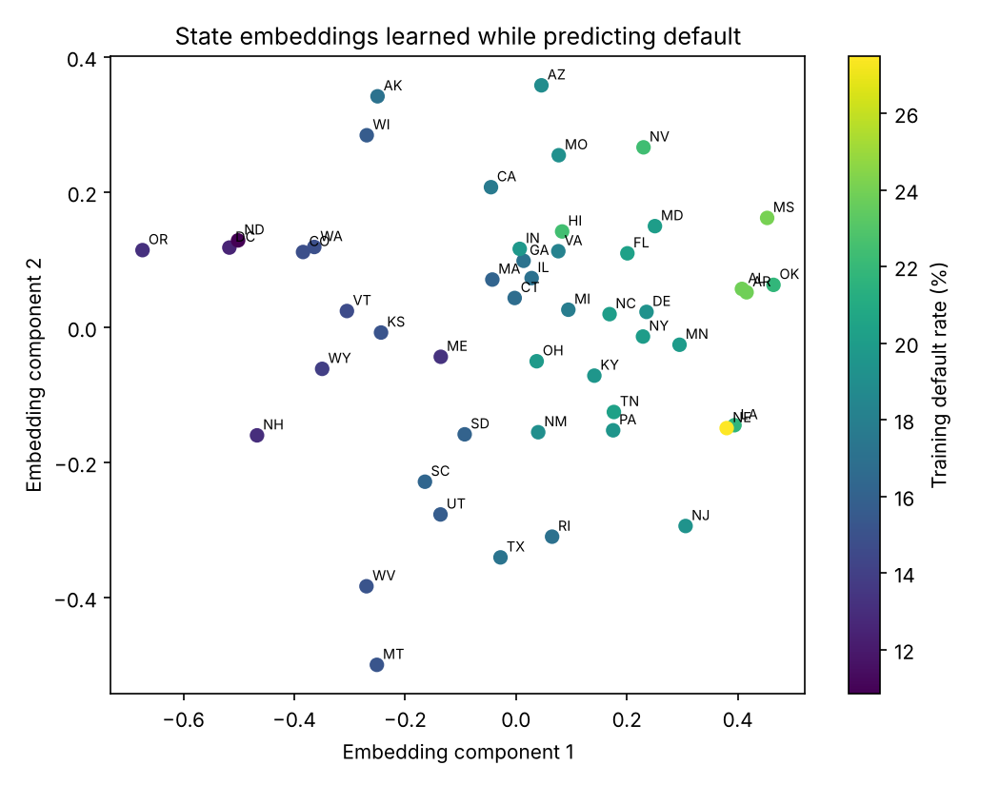

# Entity embeddings

Generated by `python -m loan_default.embedding`.

## Model comparison

| Candidate | CV ROC-AUC | CV AP | Test ROC-AUC | Test AP | Test default rate, safest 80% | Test ROC-AUC vs baseline |
|---|---:|---:|---:|---:|---:|---:|
| one-hot + target encoding (production) | 0.6633 | 0.2998 | 0.6639 | 0.3599 | 19.48% | +0.0000 |
| embedding network on its own | 0.6627 | 0.2971 | 0.6637 | 0.3577 | 19.38% | -0.0003 |
| boosting on learned embeddings | 0.6638 | 0.2998 | 0.6647 | 0.3604 | 19.45% | +0.0008 |
| embedding network, with ZIP (comparison only) | 0.6619 | 0.2971 | 0.6626 | 0.3542 | 19.41% | -0.0013 |
| boosting on learned embeddings, with ZIP (comparison only) | 0.6584 | 0.2939 | 0.6607 | 0.3528 | 19.51% | -0.0032 |

ZIP code stays out of the production model (geographic proxy); the last two rows measure what leaving it out costs.

## What the state embeddings learned

Network trained on all 2007-2015 loans: 9 epochs, held-out log loss 0.4605 after the first and 0.4593 at best.

Correlation between each state's first embedding component and its training default rate: 0.90. The embedding recovers the state's risk level, as target encoding does, and adds further dimensions that place states with similar borrowers together.

| State | Loans | Default rate | Embedding component 1 | Most similar states |
|---|---:|---:|---:|---|
| CA | 22,060 | 17.65% | -0.023 | AK, AZ, WA |
| NY | 12,532 | 19.99% | +0.118 | DE, NE, NC |
| TX | 12,053 | 17.25% | -0.014 | MT, SC, WV |
| FL | 10,469 | 20.32% | +0.104 | MS, OK, GA |
| IL | 6,010 | 17.05% | +0.015 | CT, AZ, VT |
| NJ | 5,587 | 19.37% | +0.158 | RI, TN, DE |
| PA | 5,188 | 19.53% | +0.091 | NM, NE, KY |
| OH | 5,016 | 19.82% | +0.019 | UT, IN, NM |
| GA | 4,797 | 17.18% | +0.007 | FL, ND, ME |
| VA | 4,546 | 18.24% | +0.039 | AZ, NC, MD |
| NC | 4,069 | 20.05% | +0.087 | NY, DE, NM |
| MI | 3,882 | 17.83% | +0.049 | MN, KY, FL |

