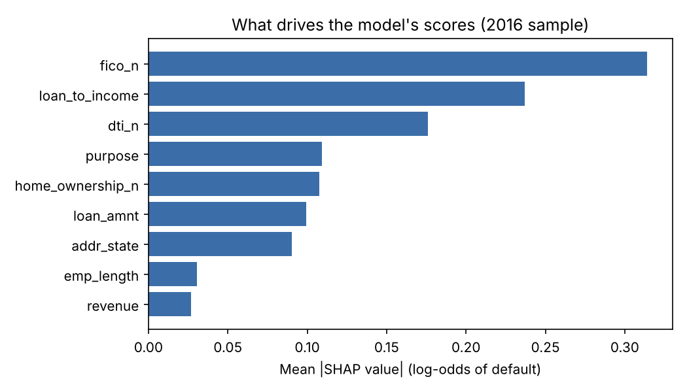
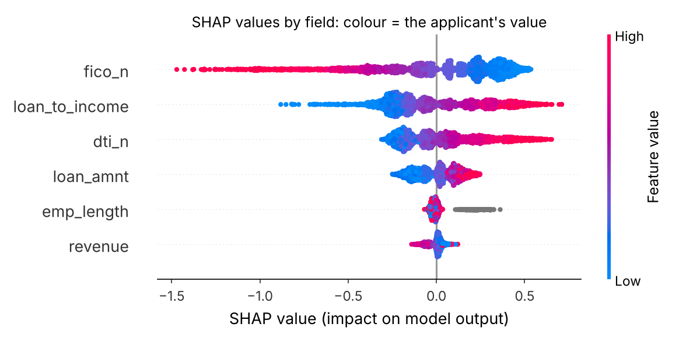
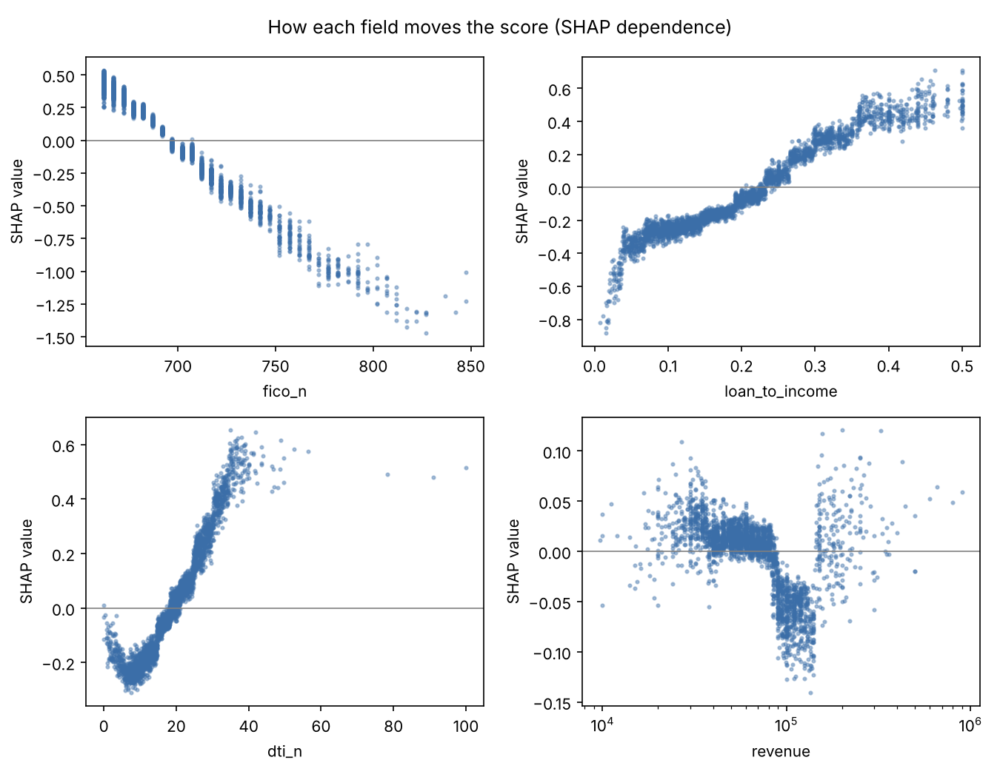
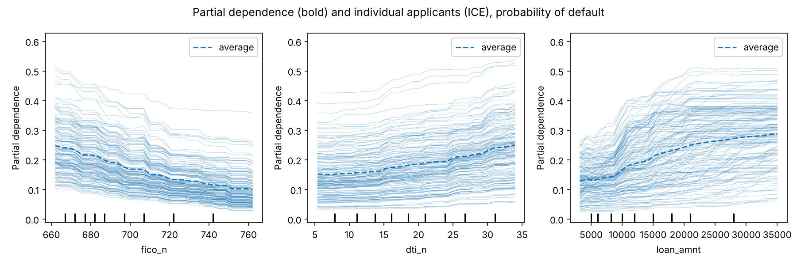

# Explainability

Generated by `python -m loan_default.explain`. SHAP values for the production model on a 3,000-loan sample of 2016, in log-odds of default. Base value -1.601 (probability 16.8%); base + contributions reproduce the model's log-odds to within 8.4e-15.

## Global importance

| Field | Mean abs. SHAP | Direction | Permutation importance (drop in test ROC-AUC) |
|---|---:|---|---:|
| fico_n | 0.314 | higher lowers risk | 0.0591 |
| loan_to_income | 0.237 | higher raises risk | n/a (derived field) |
| dti_n | 0.176 | higher raises risk | 0.0232 |
| purpose | 0.109 |  | 0.0135 |
| home_ownership_n | 0.108 |  | 0.0144 |
| loan_amnt | 0.099 | higher raises risk | 0.0648 |
| addr_state | 0.090 |  | 0.0055 |
| emp_length | 0.031 | mixed | 0.0048 |
| revenue | 0.027 | higher lowers risk | 0.0255 |

`loan_to_income` is computed from `loan_amnt` and `revenue`; SHAP credits it separately, while permutation importance shuffles the raw fields and so moves it with them.

## Individual applicants and reason codes

### Clear approval: predicted default 8.5%, decision approve (cutoff 25.6%)

| Field | Applicant's value | Contribution (log-odds) |
|---|---|---:|
| fico_n | 727 | -0.387 |
| loan_to_income | 0.12 | -0.213 |
| loan_amnt | $9,000 | -0.129 |
| home_ownership_n | RENT | +0.123 |
| addr_state | MA | -0.116 |
| dti_n | 17 | -0.061 |
| emp_length | 5 years | -0.020 |
| purpose | debt_consolidation | +0.013 |
| revenue | $75,000 | +0.009 |

### Just rejected: predicted default 25.6%, decision reject (cutoff 25.6%)

| Field | Applicant's value | Contribution (log-odds) |
|---|---|---:|
| purpose | home_improvement | +0.200 |
| fico_n | 687 | +0.178 |
| loan_amnt | $24,000 | +0.163 |
| home_ownership_n | RENT | +0.159 |
| loan_to_income | 0.17 | -0.128 |
| revenue | $140,000 | -0.064 |
| addr_state | FL | +0.059 |
| dti_n | 17 | -0.030 |
| emp_length | 10 years | -0.002 |

Reason codes: 1. Purpose of the loan; 2. Credit score; 3. Amount requested

### Clear rejection: predicted default 40.5%, decision reject (cutoff 25.6%)

| Field | Applicant's value | Contribution (log-odds) |
|---|---|---:|
| loan_to_income | 0.43 | +0.423 |
| fico_n | 682 | +0.239 |
| loan_amnt | $35,000 | +0.200 |
| home_ownership_n | RENT | +0.169 |
| dti_n | 24 | +0.115 |
| purpose | debt_consolidation | +0.038 |
| addr_state | VA | +0.021 |
| revenue | $81,000 | +0.011 |
| emp_length | 10 years | -0.001 |

Reason codes: 1. Amount requested is large relative to income; 2. Credit score; 3. Amount requested

State of residence can appear as a reason. A lender should check with compliance whether a geographic reason is acceptable, since geography can proxy for protected characteristics (see the fairness report).
