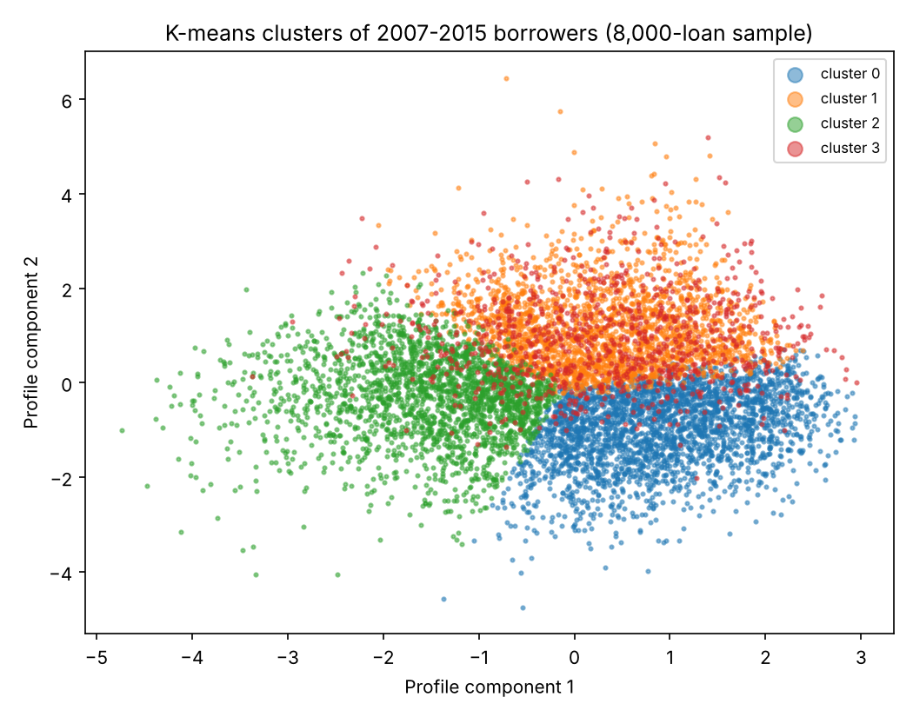

# Unsupervised analysis: principal components and clusters

Generated by `python -m loan_default.unsupervised`.

## Principal components of the preprocessed features

23 standardized features. Components needed: 15 for 80% of the variance, 18 for 90% of the variance, 19 for 95% of the variance.

| Component | Variance explained | Cumulative | Largest loadings |
|---|---:|---:|---|
| PC1 | 10.1% | 10.1% | home_ownership_n_MORTGAGE (+0.53), home_ownership_n_RENT (-0.51), revenue (+0.39), loan_amnt (+0.38) |
| PC2 | 8.5% | 18.6% | purpose_debt_consolidation (+0.51), loan_to_income (+0.51), loan_amnt (+0.35), dti_n (+0.29) |
| PC3 | 6.9% | 25.6% | purpose_credit_card (+0.64), purpose_debt_consolidation (-0.52), loan_to_income (+0.40), loan_amnt (+0.26) |

## Choosing the number of clusters

| k | Inertia | Silhouette |
|---:|---:|---:|
| 2 | 731,628 | 0.183 |
| 3 | 618,717 | 0.179 |
| 4 | 560,144 | 0.177 |
| 5 | 508,321 | 0.173 |
| 6 | 472,659 | 0.166 |
| 7 | 444,668 | 0.166 |
| 8 | 421,901 | 0.162 |
| 9 | 402,182 | 0.161 |
| 10 | 386,154 | 0.157 |

Silhouette scores are low and fall slowly with k: the borrowers form a continuum rather than well-separated groups. We use k = 4, the largest k within 0.01 of the best score, so the clusters are a readable summary of the population rather than natural segments.

## The 4 borrower clusters, safest first

| Cluster | Share 2007-2015 | Share 2016 | Mean FICO | Median income | Median loan | Loan / income | Median DTI | Default 2007-2015 | Default 2016 | Description |
|---:|---:|---:|---:|---:|---:|---:|---:|---:|---:|---|
| 3 | 12.0% | 12.1% | 757 | $74,000 | $14,000 | 0.20 | 13.7 | 8.7% | 11.1% | higher FICO, low DTI |
| 2 | 27.7% | 29.5% | 686 | $50,000 | $6,000 | 0.12 | 16.9 | 15.7% | 20.8% | short employment, small loan for income |
| 1 | 27.0% | 28.6% | 690 | $100,000 | $17,400 | 0.17 | 13.6 | 15.9% | 21.4% | higher income, long employment |
| 0 | 33.3% | 29.8% | 691 | $51,000 | $16,000 | 0.33 | 23.2 | 26.3% | 32.5% | high DTI, large loan for income |

## Do components or clusters help the model?

| Candidate | CV ROC-AUC | CV AP | Test ROC-AUC | Test AP | Test default rate, safest 80% | Test ROC-AUC vs baseline |
|---|---:|---:|---:|---:|---:|---:|
| production features | 0.6633 | 0.2998 | 0.6639 | 0.3599 | 19.48% | +0.0000 |
| first 19 principal components only | 0.6596 | 0.2939 | 0.6624 | 0.3581 | 19.45% | -0.0016 |
| production + distances to 4 cluster centres | 0.6631 | 0.2995 | 0.6640 | 0.3595 | 19.47% | +0.0001 |
